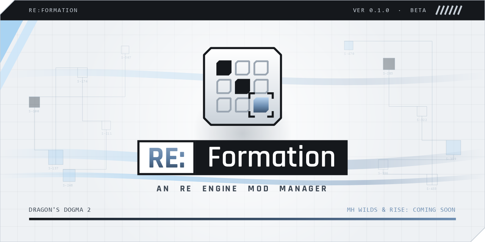

# RE:Formation

**An RE Engine mod manager.**

RE:Formation keeps your mods in one place: a library, profiles, options and load order. It Deploys them into the game and cleans up after itself.

**Supported:** Dragon's Dogma 2. Monster Hunter Wilds and Monster Hunter Rise are coming soon.

## Download

Get the **RE-Formation-Setup** installer from [Releases](https://github.com/Avaleine/re-formation/releases/latest).

It installs for your Windows user only, so there's no admin prompt. Your mods, profiles and settings live in `%APPDATA%\RE-Formation` and stay as they are through updates and uninstalls.

## You need

- Windows 10 or 11, 64-bit
- [REFramework](https://github.com/praydog/REFramework) installed in the game

## What it does

- **Library and profiles.** Add mods from .zip, .7z or .rar. Each game has its own library, and profiles let you keep different setups.
- **Options.** For mods that come in several versions, pick the options you want.
- **Load order.** The mod lower in the list wins.
- **Deploy and Purge.** Deploy puts a profile into the game and records every file it places. Purge removes only those files, and leaves alone any file you changed after the Deploy.
- **Clash warnings.** File contents are compared, so mods that ship identical copies of a file aren't flagged. Only real conflicts are, with a fix to reorder them.
- **Library check.** When a script mod needs a library such as _NickCore or _XYZApi, you'll see it, with a link to switch the library on.
- **Fluffy import.** Your mods, options and load order from Fluffy Mod Manager arrive as a new profile.
- **Quick start tour** on first launch, with tips for anyone coming from Fluffy. Replay it any time from Settings or the ? on the bottom bar.
- **Light and dark theme.**

## Moving over from Fluffy Mod Manager

1. Open Dragon's Dogma 2 in RE:Formation. The first time, it offers to import your Fluffy mods, options and load order.
2. In Fluffy, use **Uninstall all**, so its files leave the game.
3. Deploy in RE:Formation.

## Checking the download

Run `certutil -hashfile RE-Formation-Setup-0.1.0.exe SHA256` and compare the result with the `.sha256` file on the release.

## Feedback

Found a bug? Open an [issue](https://github.com/Avaleine/re-formation/issues) and include a screenshot and RE:Formation's log.

## Licences

RE:Formation is free. Third-party licences are in the install folder, in THIRD_PARTY_NOTICES and the licences folder.
